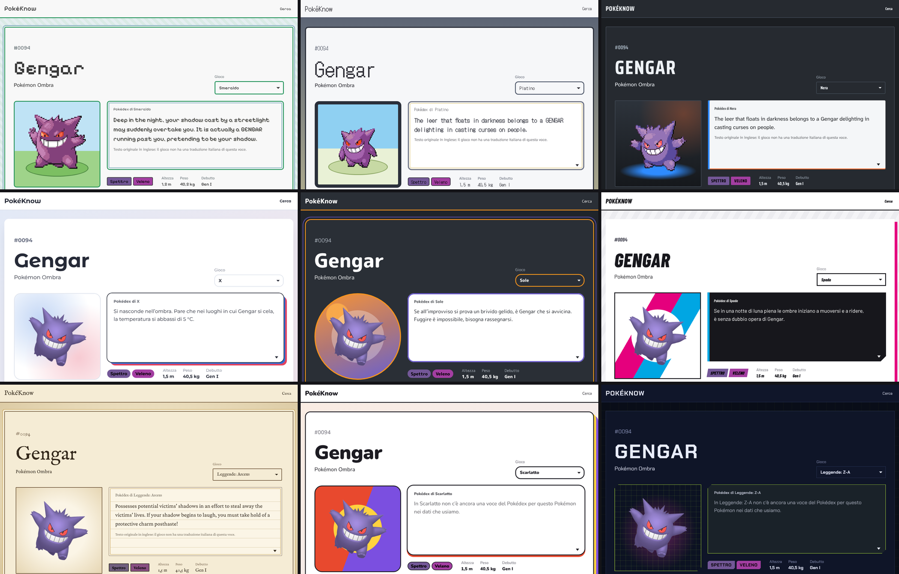

# PokéKnow

**A Pokédex for every generation.** Pick a Pokémon, pick a game, and the whole page adapts: type matchups computed with that generation's rules, the stats and abilities it had back then, the Pokédex entry from that exact version, and a UI theme inspired by the era of the game.

**Live site:** [English](https://vittorio-2001.github.io/PokeKnow/en/) · [Italiano](https://vittorio-2001.github.io/PokeKnow/)



## Features

- **Game by game, from the Game Boy Advance to today**: 18 games from Ruby and Sapphire to Legends: Z-A, each version selectable on its own.
- **Generation-accurate rules**:
  - type matchups use the type chart of the selected generation: Fairy only exists from Gen VI, and Steel resisted Ghost and Dark until Gen V;
  - Pokémon types changed over time are respected (Clefable is Normal until Gen V, Fairy afterwards);
  - so are base stats (Pikachu's Defense in Gen VI) and abilities, with hidden abilities only from Gen V;
  - games without abilities (Let's Go, the Legends titles) say so instead of showing wrong data.
- **Evolution chain**: the whole family as a tree with era sprites and links, showing how each stage evolves in the selected game (Leafeon needs the Moss Rock in Platinum and a Leaf Stone in Sword) and only the Pokémon that exist in that generation.
- **Deeper stats**: minimum and maximum values at levels 50 and 100 for every stat, and the EVs the Pokémon gives when defeated.
- **Cry, shape and footprint**: a button on the sprite stage (or a click on the sprite) plays the Pokémon's cry, original up to Gen V and modern afterwards, while the sprite hops. Next to height and weight sit the body shape, as in the games' Pokédex search, and the footprint (Gen I–V, from veekun).
- **Search by shape**: like the in-game Pokédex, the home page filters by the 14 body shapes, with pixel pictograms drawn for PokéKnow.
- **Catching and breeding**: catch rate with the chance of a Poké Ball at full HP, base friendship and experience, growth rate, gender ratio, egg groups and egg cycles.
- **Where to find it**: for every game, a one-line summary (how many wild locations and from which level, gifts and in-game trades), **version exclusives** compared with the twin version (and whether the other version can get it by evolution or needs a trade), then the locations where the Pokémon appears with the method (grass, surfing, fishing, gifts, Wanderers…), levels, encounter rate and conditions such as time of day, weather, swarms or the GBA slot, plus how it evolves in that game.
- **Mega Evolutions**: in the games where they exist (X and Y, Omega Ruby and Alpha Sapphire, Sun and Moon, Ultra Sun and Ultra Moon, Let's Go for the Kanto ones, and Legends: Z-A with its new Megas), a button on the sprite stage switches to the Mega form: sprite, name, types, matchups, stats, ability, height and weight change, and the Mega Stone is shown with its icon. Megas also appear at the end of the evolution chain, with a dashed arrow and the Mega Stone, and the active Mega is kept in the URL (`?mega=charizard-mega-x`).
- **Learnable moves**: for every game, the moves learned by level up, TM and HM (TR in Sword and Shield), egg and tutor, each with the type, category, power, accuracy and PP it had in that game, a search box that filters every tab as you type, and a note when a TM, egg or tutor move is also learned by level up: Charm is Normal before X and Y, and in Gen III Shadow Ball is physical because the category still depended on the type. The default game is in the page; the others are loaded only when you switch game.
- **Link previews**: sharing a Pokémon page on WhatsApp, Discord, Reddit or Telegram shows a card with that Pokémon in the style of its default game, rendered from the site's own CSS.
- **Shiny sprites**: a toggle on the sprite stage shows the shiny version from the same era's sprite set, and the choice is remembered.
- **Nine era themes**: each generation has its own colors, typefaces, shapes, text box and sprite stage, inspired by the interfaces of its games.
- **Version palettes**: every game pairs the colors of its two versions. Choose Sun and the sky fades from sun-orange into moon-violet; choose Moon and it flips. White and White 2 get a light take on the Unova theme.
- **Sprites from each era**: original pixel art up to Gen V (animated in Black and White), 3D renders afterwards. Every sprite is measured at runtime so its feet rest on the battle platform instead of floating above it.
- **Shareable state**: the chosen game lives in the URL (`?gioco=emerald`) and is remembered while you browse from one Pokémon to the next.
- **Italian and English**: the whole interface, Pokémon names, categories, abilities and Pokédex entries in both languages, with a language switch that keeps the game you picked.
- **Search and filters**: search by name or National Dex number, filter by type.
- **Light and dark home**: Solrock and Lunatone swap places to switch the home page between light and dark, following the system setting until you choose.
- **Responsive and accessible**: works down to phone width, keyboard focus is always visible, and the typewriter effect respects reduced-motion settings.

## How it works

**Static data pipeline.** `scripts/fetch-data.mjs` downloads the official [PokéAPI](https://pokeapi.co) CSV dumps from GitHub once, caches them, and turns them into compact JSON. The site never calls an API at runtime: it is fully static, fast, and respects PokéAPI's fair use policy.

**History-aware data.** PokéAPI keeps past values in `*_past` tables, where each row is valid *up to and including* a given generation. The script resolves them for every generation from III to IX, so each game gets the types, stats, abilities and type chart it actually had.

**One renderer, two runtimes.** `src/lib/render.ts` holds pure functions that return the HTML of each section. Astro calls them at build time to generate the 1,025 static pages, and the browser calls the very same functions when you switch game. No duplicated markup and no client-side framework.

**Themes as design tokens.** The layout is defined once in `global.css`. Each era theme in `themes.css` only redefines CSS custom properties (colors, fonts, radii, text box frame, stage background), plus a handful of signature details. Version palettes are two more tokens, `--v1` for the chosen version and `--v2` for its counterpart. A tiny inline script in `<head>` applies the right theme before the first paint, so you never see a flash of the wrong one.

**Sprite anchoring.** Sprites come with different amounts of transparent padding. `src/lib/sprite-anchor.ts` reads the visible pixels through a canvas and shifts the image so it is grounded on themes with a platform, or truly centered on the others.

**Internationalization without a framework.** Every interface string lives in one typed dictionary per language (`src/lib/i18n.ts`); a test fails if a language is missing a key. Italian is served at the root and English under `/en/`, with `hreflang` alternates for search engines. Pages are thin wrappers around shared components, so adding a language means adding a dictionary and two route files.

**Link preview cards.** Each Pokémon has a hidden 1200×630 page that reuses the era theme, the type chips and the sprite stage. After the build, `scripts/og-cards.mjs` serves `dist/`, photographs those pages with headless Chrome through `playwright-core`, writes `og/<lang>/<slug>.jpg` and deletes the hidden pages. Cards are cached by a hash of their HTML, so a deploy only re-renders the cards whose content or style changed.

**Continuous deployment.** A GitHub Actions workflow runs the tests, builds the site and publishes it to GitHub Pages on every push to `main`. The base path is detected automatically, so the same code works under `/PokeKnow/` or on a custom domain.

## Tech stack

- [Astro](https://astro.build) 7 for static site generation, with TypeScript throughout
- Vanilla JavaScript on the client: no framework, a single small script per page
- [PokéAPI](https://pokeapi.co) data (CSV dumps) and sprites
- Self-hosted fonts through [Fontsource](https://fontsource.org): no requests to Google Fonts
- [Vitest](https://vitest.dev) for the type chart, the translations, the Pokédex entry fallback, evolutions, encounters, evolution chains, stat formulas and move data
- GitHub Actions and GitHub Pages

## Getting started

Requires Node.js 22.23.4 or later.

```bash
npm install
npm run dev      # downloads the data on first run, then starts the dev server
npm run build    # generates the static site in dist/
npm test         # unit tests
npm run og       # after a build: link preview cards (a few minutes the first time)
```

To refresh the PokéAPI data: `npm run data -- --refresh`.

## Project structure

```
scripts/fetch-data.mjs           data download and transformation
src/lib/data.ts                  data types and helpers
src/lib/typechart.ts             weaknesses, resistances and coverage per generation
src/lib/where.ts                 encounters and how each Pokémon evolves
src/lib/chain.ts                 evolution family as a tree, per game
src/lib/stats.ts                 stat ranges and catch chance
src/lib/forms.ts                 Mega Evolutions: where they exist and the Mega form of a page
src/lib/moves.ts                 learnable moves and their values in each game
src/lib/shapes.ts                body shapes and their pixel pictograms
src/lib/render.ts                section HTML, shared by the build and the browser
src/lib/themes.ts                which theme and which sprites for each game
src/lib/sprite-anchor.ts         grounds sprites on the platform
src/lib/url.ts                   internal links that work under any base path
src/lib/i18n.ts                  interface strings for every language
src/lib/paths.ts                 static routes shared by all languages
src/components/                  home and Pokémon page, shared by all languages
src/pages/                       Italian routes (index, pokemon/[slug])
src/pages/en/                    English routes
src/pages/data/moves/[id].json.ts  per-Pokémon move files, loaded on demand
src/pages/og-card/               link preview cards, photographed after the build
scripts/og-cards.mjs             renders the link preview cards
src/styles/global.css            shared layout and the black-and-white base theme
src/styles/themes.css            era themes and version palettes
src/styles/fonts.css             self-hosted fonts
tests/                           Vitest tests
.github/workflows/deploy.yml     test, build and deploy to GitHub Pages
```

## Known data gaps

- **Italian Pokédex entries**: PokéAPI only has them from X and Y up to Sword and Shield. When a game has no entry in the page language, the site shows the entry from the nearest game in that language, says which game it comes from, and keeps the game's original text one click away.
- **Scarlet and Violet** have few entries in PokéAPI, and **Legends: Z-A** none yet. These games show the nearest available entry, clearly labeled with its source game.
- Regional variants, Gigantamax and Primal Reversion are not included yet. Mega Evolutions are, but only for the default form (no Mega for female Meowstic or for the other Tatsugiri forms). In Legends: Z-A every returning Mega is assumed to be available, since PokéAPI does not list them per game.
- **Encounter locations** are missing for Brilliant Diamond and Shining Pearl, Legends: Arceus, Scarlet and Violet, and Legends: Z-A, and partial for Omega Ruby and Alpha Sapphire.
- **Moves for Legends: Z-A** are not in PokéAPI yet: the page says so. Many location names have no Italian translation in PokéAPI: the site uses the English name, turning "Route 12" into "Percorso 12".

## Roadmap

1. Regional forms.
2. More languages.
3. A custom domain.

## License

The source code is released under the [MIT License](LICENSE). The license covers the code only: Pokémon data, names, sprites and trademarks belong to their respective owners, the site icon follows the Icons8 license, and fonts keep their own licenses.

## Credits and disclaimer

Data and sprites come from [PokéAPI](https://pokeapi.co), cries from [PokéAPI Cries](https://github.com/PokeAPI/cries), footprints from the [veekun](https://veekun.com/dex/downloads) collection by eevee/lexy munroe (stored as vector paths in `src/data/footprints.json`). Body-shape pictograms are original pixel art made for PokéKnow. The site icon is [Pokedex](https://icons8.com/icon/ih6hQU67d27H/pokedex) by Those Icons on [Icons8](https://icons8.com). Fonts are distributed under the SIL Open Font License through Fontsource.

PokéKnow is a free, non-commercial fan project. It is not affiliated with, endorsed or sponsored by Nintendo, Creatures Inc., GAME FREAK or The Pokémon Company. Pokémon and Pokémon character names are trademarks of their respective owners.
